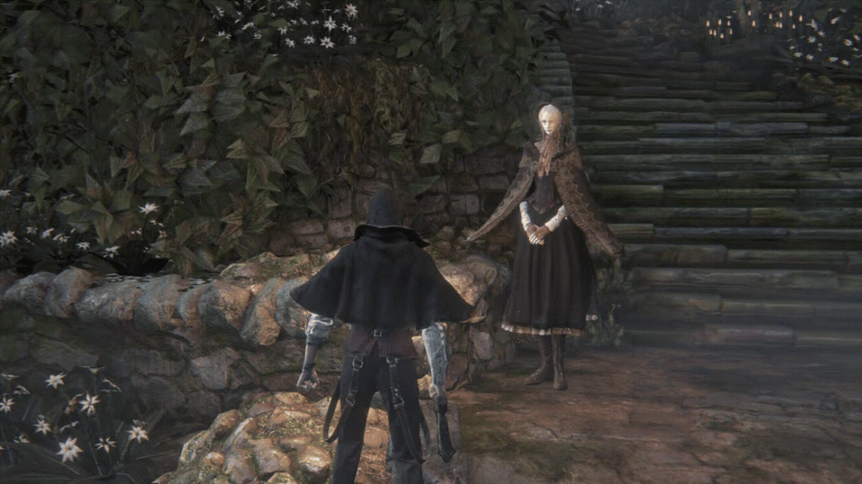

> [!IMPORTANT]
> **THIS PROJECT IS NOT RELATED TO SHADPS4.**
> All questions regarding the original porting project should be directed to the original creator's Discord server: **https://discord.gg/KYZRKk9CB**, NOT to the shadPS4 server.
>
> **Original Upstream Repository:** [https://github.com/deadinside28/bloodborne_pc](https://github.com/deadinside28/bloodborne_pc) (created by [deadinside28](https://github.com/deadinside28))

# bbport (Custom Fork) — Native Linux Port of Bloodborne

> [!NOTE]
> **About this Fork:**
> This repository is a **simple personal fork** of the original [bbport](https://github.com/deadinside28/bloodborne_pc) by **deadinside28**. It introduces a collection of quality-of-life enhancements, refined user interfaces, expanded gamepad integration, and visual indicators tailored to personal taste, while preserving the high-performance native execution architecture of the upstream project.

---

## ✨ Fork Enhancements & Highlights

Here are some of the key additions and custom improvements featured in this fork:

### 1. In-Game Virtual Keyboard with Full Gamepad Navigation
Creating a character name no longer requires a physical keyboard! An on-screen virtual keyboard is integrated directly into the character creation screen with complete controller navigation, button glyphs, and responsive physical keyboard support.


- **Gamepad Controls:**
  - **D-Pad / Left Stick**: Move cursor across letters and buttons
  - **(A / ✕)**: Insert character
  - **(X / ▢)**: Backspace / Delete
  - **(Y / △)**: Space
  - **(LB / RB / L1 / R1)**: Toggle Caps Lock
  - **(Start)**: Confirm / OK
  - **(B / ◯)**: Cancel / Close
- **Keyboard Support**: Physical typing with Backspace, Space, Enter, and Esc.

---

### 2. AMD FSR 3.1 Frame Generation (FG)
Experience Bloodborne with dramatically elevated smoothness via integrated **FSR 3.1 Frame Generation**, switchable directly in real-time from the in-game overlay menu.


- Interpolates intermediate frames using native motion vectors, scene depth, and reactivity masks.
- Easily reach 60 to 120+ FPS on compatible hardware for fluid combat.

---

### 3. Redesigned In-Game Overlay Menu (Insert / L3+R3)
The in-game configuration overlay has been overhauled for better organization, clarity, and instant control over rendering technologies.


- **Multilingual UI**: Seamless switching between **English**, **Português (Brasil)**, and **Русский**.
- **Real-Time Upscaler Tweaks**: Instant toggles for FSR 4, FSR 4.1.1, FSR 3.1, and TAA.
- **Reactivity Masks & Motion Vectors**: Fine-tune reactivity scale, threshold, max values, and character motion vectors with live visual debug modes.
- **Live Output Resolution & Visual Effects**: Adjust display resolution, RCAS sharpness slider, subpixel jitter, Chromatic Aberration, and Depth of Field (DoF).

---

### 4. Background Shader Compilation HUD Indicator
No more wondering why a micro-stutter occurred! A sleek, non-intrusive status spinner and progress bar appear on the HUD whenever background asynchronous shaders are compiling.


- Real-time framerate, frametime, upscaler state, and compilation status: `59 \ 59 FPS 16.9 ms FSR 4 + FG | ◷ Shaders`.

---

### 5. Organized GTK4 Launcher & Native Gamepad Navigation
The launcher has been reorganized into clean, dedicated preference groups with full Brazilian Portuguese (`pt-BR`) localization and complete gamepad navigation.


- **Launcher Gamepad Navigation**: Navigate tabs, rows, toggles, sliders, and launch the game directly using your controller (Xbox, DualShock 4, DualSense, Switch Pro, Steam Deck).
- **Dynamic Hints Bar**: Displays connected controller model and available button shortcuts (`[LB/RB] Tabs`, `[D-Pad] Navigate`, `[A] Select`, `[B] Back`, `[Y] Focus Play`, `[Start] Launch`, `[RS] Scroll`).
- **Bloodborne Red Outline**: Prominent focus outline for couch gaming or handheld display modes.

---

## 🏛️ What is bbport?


`bbport` is the equivalent of Wine + DXVK engineered specifically for a single title: **Bloodborne** for PlayStation 4 (CUSA03173, version 1.09) running natively on x86-64 Linux:

- **As in Wine**, the game's x86-64 code executes directly on the CPU without instruction emulation; a tailored runtime replaces the PS4 OS system libraries.
- **As in DXVK**, the game's graphics are translated to Vulkan by a renderer derived from [shadPS4](https://github.com/shadps4-emu/shadPS4) and heavily extended with custom motion vectors, temporal upscaling (AMD FSR 3.1, FSR 4, FSR 4.1.1, NVIDIA DLSS), and multi-threading.
- **Memory & GPU pipeline**: Implements a PC-style memory model on AMD GPUs (direct system RAM access, cached VRAM, translated Vulkan command streams) alongside the classic page-protection model for NVIDIA and other GPUs.

> **No game files or copyrighted assets are included.**
> You must supply your own decrypted dump of Bloodborne with update 1.09 (any retail edition: CUSA03173, CUSA00900, CUSA03023, etc.).
> This project is not affiliated with Sony Interactive Entertainment, FromSoftware, or AMD.

---

## 📊 Comparison with shadPS4

| Feature | shadPS4 | bbport |
| :--- | :--- | :--- |
| **Scope** | General PS4 emulator for multiple titles | Dedicated native runtime specifically for Bloodborne v1.09 |
| **Execution** | Dynamic ELF loader & kernel emulation | Offline conversion into a flat memory image; native PS4 libc/Fios2 linkage |
| **CPU Speed** | Emulation layer overhead | Full native x86-64 CPU speed with zero translation overhead |
| **GPU Command Stream** | Decoded on a single CPU thread | Decoded on one thread, draw calls recorded on another (two-stage pipeline) |
| **Memory Model** | VRAM mirror copies with page protection | Dual models: PC-style memory arena (AMD) & classic page protection (NVIDIA) |
| **Upscaling** | Basic or none | Temporal upscaling (FSR 3.1, FSR 4 INT8, FSR 4.1.1 bit-exact, DLSS, TAA) with custom motion vectors |
| **Frame Generation** | Not available | AMD FSR 3.1 Frame Generation integrated with motion vector interpolation |
| **Virtual Keyboard** | Standard dialog | Fully navigated in-game virtual keyboard for controllers |

---

## ⚙️ System Requirements

- **Operating System:** Linux x86-64.
- **Graphics Card:** GPU supporting Vulkan 1.3 (tested on AMD Radeon RX 7000 / RDNA 2/3 with Mesa/RADV; NVIDIA supported via classic memory model).
- **Shader Features for FSR 4 / 4.1.1:** Requires Float16, Int8/Int16, integer dot products, and linear compute derivatives (`VK_VALVE_shader_mixed_float_dot_product` for FSR 4.1.1). Unsupported hardware seamlessly falls back to FSR 3.1 or TAA.
- **Game Dump:** Decrypted Bloodborne dump folder (`CUSA03173` or regional variants) updated to version **1.09**.
- **Build Dependencies:** GCC / Clang, CMake, Ninja, Python 3, glslang, SDL3, and Vulkan headers (or `nix-shell` via `shell.nix`).

---

## 🚀 Building & Running

### 1. Clone the repository
```bash
git clone --recursive https://github.com/deadinside28/bloodborne_pc.git bbport
cd bbport
```

### 2. Build the binaries
```bash
bash build.sh
```
This compiles `out/bb-probe` (the native loader) and `out/gpu/libbbgpu.so` (the Vulkan translation runtime).

### 3. Launching
You can run via the GTK4 launcher (recommended):
```bash
bash launcher/bb-launcher.sh
```
*Or launch directly via terminal:*
```bash
BB_GAME_DIR=/path/to/CUSA03173 bash run.sh
```

---

## 🎮 Controls & Shortcuts

| Context | Input | Action |
| :--- | :--- | :--- |
| **In-Game Overlay** | `Insert` or `L3 + R3` | Open / Close the in-game settings overlay |
| **Character Name** | In-game dialog | Interactive virtual keyboard (controller & physical keyboard) |
| **Launcher Navigation** | `D-Pad` / `Left Stick` | Move focus between launcher settings and categories |
| **Launcher Values** | `D-Pad Left/Right` | Adjust sliders, cycle combo options, and toggle switches |
| **Launcher Pages** | `LB` / `RB` (L1 / R1) | Switch launcher tabs |
| **Launcher Quick Play**| `Start` or `Y` | Immediate game launch / focus main action button |
| **Page Scrolling** | `Right Stick (RS)` | Smooth vertical scroll in launcher and menus |
| **Touchpad Gestures** | Left Touchpad / `Tab` | Open gestures menu (or debug menu if enabled) |
| **Touchpad Items** | Right Touchpad / `Backspace` | Open personal items menu |
| **Free Camera** | Hold `✕` + press `L3` | Cycle camera modes (requires free camera patch) |


*(Performing gestures with the Plain Doll in the Hunter's Dream — open the gesture menu with `Tab` or Touchpad)*

---

## 📁 Repository Layout

| Path | Purpose |
| :--- | :--- |
| `src/` | Native loader (`probe.c`) and high-level emulation (HLE) runtime (`runtime_*.c`) |
| `gpu/` | Vulkan translation renderer (vendored shadPS4 video core + custom Bloodborne pipeline, FSR 4.1.1 replayer, Frame Generation, and ImGui overlay) |
| `launcher/` | Modern GTK4 / Libadwaita launcher with full controller navigation, i18n, and settings persistence |
| `prints/` | Screenshots showcasing custom fork enhancements, UI redesigns, and controls |
| `scripts/` | Image linker, eboot unpacker, libc/fios2 linkers, and XML patch compiler |
| `patches/` | Community performance and graphics patches (`Bloodborne.xml`) |
| `tools/` | Developer utilities: `fsr4cap`, automated benchmarks, asset downloaders, and test scripts |
| `tests/` | Comprehensive test suite (115+ automated unit tests for runtime, patches, and gamepad navigation) |
| `docs/` | Technical design documentation, measurements, and architectural roadmap |

---

## 🏆 Credits, Attribution & Licenses


`bbport` is distributed under the **GNU General Public License v2.0 or later** ([LICENSE](LICENSE)). Third-party components, libraries, and patches retain their respective original licenses.

### Upstream Project & Port Architecture
- **Original Project Creator:** [deadinside28](https://github.com/deadinside28) ([deadinside28/bloodborne_pc](https://github.com/deadinside28/bloodborne_pc)) — Architect of bbport: native x86-64 execution, Wine-style PS4 HLE runtime (`src/runtime_*.c`), memory arena model, offline eboot/ELF conversion, parallel GPU decoding/recording pipeline, and custom motion vector generation.
- **Official Creator Discord:** [https://discord.gg/KYZRKk9CB](https://discord.gg/KYZRKk9CB) — Primary community server for upstream development and bug reports.

### Emulation & Graphics Translation
- **[shadPS4](https://github.com/shadps4-emu/shadPS4)** (GPL-2.0+): The core video renderer (`video_core`) and shader recompiler (`shader_recompiler`) that form the foundation of bbport's graphics translation engine.
- **[sirit](https://github.com/shadps4-emu/sirit)** (shadPS4 project): Lightweight SPIR-V runtime assembly generation library.
- **[shadNet / shadp2p](https://srv.shadps4.net)**: Online networking client and server infrastructure for Bloodborne messages, bloodstains, spectres, and cooperative matchmaking.
- **Khronos Group & Vulkan**: The Vulkan 1.3 low-level graphics API, validation layers, and SPIR-V tooling.
- **Wine & DXVK Projects**: The foundational concept and architectural inspiration for native Linux single-game translation runtimes.

### Upscaling, Reconstruction & Frame Generation
- **[AMD FidelityFX SDK](https://github.com/GPUOpen-LibrariesAndSDKs/FidelityFX-SDK)** (MIT): FidelityFX Super Resolution (FSR 3.1) algorithms, Robust Contrast Adaptive Sharpening (RCAS), subpixel jittering, and Frame Generation interpolation pipeline.
- **[FSR-Vulkan](https://github.com/FireBurn/FSR-Vulkan)** by FireBurn (MIT): Native Vulkan implementations of AMD FSR 3.1 and the FSR 4 v07 provider.
- **FSR 4.1.1 Replay Pipeline**:
  - **[dxil-spirv](https://github.com/HansKristian-Work/dxil-spirv)** by Hans-Kristian Arntzen (MIT): Translates DirectX 12 DXIL passes into native Vulkan SPIR-V compute shaders for bit-exact execution in `fsr4cap`.
  - Research and model workflows inspired by the **OptiScaler** and **Goverlay** open-source communities.
- **[NVIDIA DLSS SDK](https://github.com/NVIDIA/DLSS)**: Deep Learning Super Sampling technology and NGX Linux runtime library.
- **[Supermedo's Windows Port](https://github.com/Supermedo/bloodborne_pc)** & **[IFreemz](https://github.com/IFreemz/shadPS4-Bloodborne-DLSS-FSR)**: The original DLSS bridge concept, loader integration, and motion vector hooks.

### Input, Gamepad & Virtual Keyboard
- **[SDL3 (Simple DirectMedia Layer 3)](https://www.libsdl.org/)** (zlib): Low-latency controller input, unified gamepad mappings (Xbox 360 / One / Series, PlayStation DualShock 4 / DualSense, Nintendo Switch Pro, Steam Deck), hotplugging detection, and analog stick polling across both the game runtime and the GTK4 launcher.
- **Custom In-Game Virtual Keyboard**: Built specifically for the character creation contract screen with full controller navigation, button glyphs, and physical keyboard support.
- **GTK4 Gamepad Navigator**: Custom SDL3-powered navigation engine for the GTK4 / Libadwaita launcher, supporting D-Pad navigation, smooth analog scrolling, popover choice dropdowns, and modal dialogs.

### Audio, Typography & User Interface
- **[LibAtrac9](https://github.com/Thealexbarney/LibAtrac9)** by Thealexbarney (MIT): High-performance native ATRAC9 audio decoding for PlayStation 4 audio streams, sound effects, and orchestral music.
- **[Dear ImGui](https://github.com/ocornut/imgui)** by Omar Cornut (MIT): Lightweight in-game configuration overlay and real-time performance metrics HUD.
- **[GNOME / Libadwaita & GTK4](https://gitlab.gnome.org/GNOME/libadwaita)** (LGPL-2.1+): Modern, accessible desktop launcher interface with custom CSS theming, organized preference groups, and i18n support.
- **[DejaVu Fonts](https://dejavu-fonts.github.io/)**: Clear, high-legibility Unicode fonts used in the game overlay and debugging menus.

### Game Patches, Modding & Community Research
- **Lance McDonald**: Pioneer of the Bloodborne 60 FPS patch, physics delta time decoupling research, frame pacing analysis, GoldHEN free camera patch, and game internals exploration.
- **Kyo**: Motion vector extraction hooks, simulation delta scaling, and graphics patches.
- **auser1337, illusion, emoose, and the Bloodborne modding community**: Resolution patches, game effects toggles (DoF, Chromatic Aberration), XML patch compilation, and modding tools (`patches/Bloodborne.xml`).
- **FromSoftware & Sony Interactive Entertainment**: The original creators and publishers of Bloodborne (CUSA03173 / CUSA00900 / CUSA03023).

### Packaging, Monitoring & System Tools
- **[MangoHud](https://github.com/flightlessmango/MangoHud)**: Performance monitoring, FPS, and frametime tracking overlay.
- **Nix / NixOS & AppImageKit**: Reproducible development environment (`shell.nix`) and standalone portable package creation for Linux desktops and the Steam Deck.
