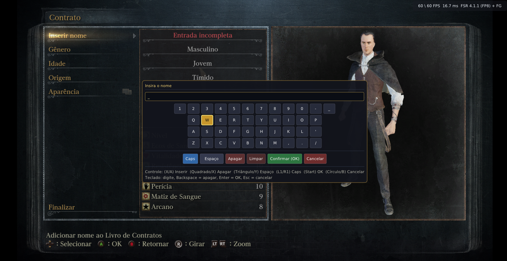
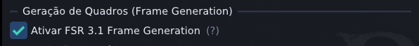
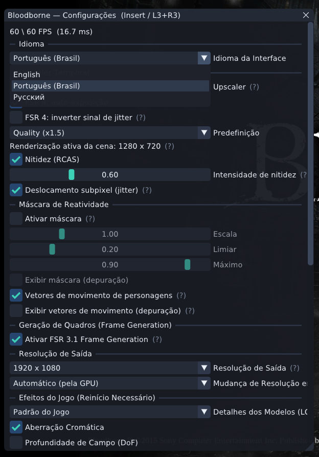
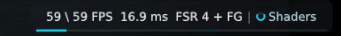
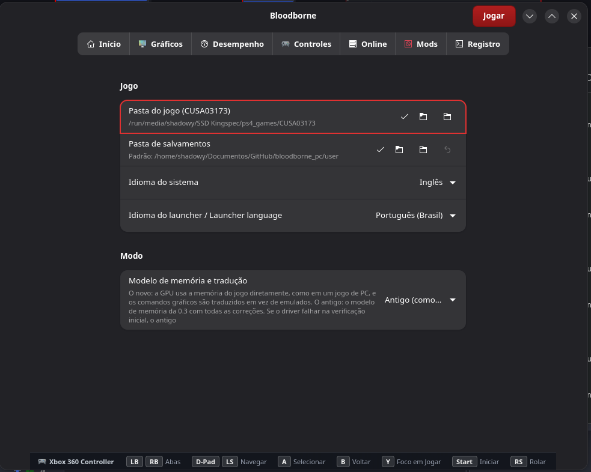
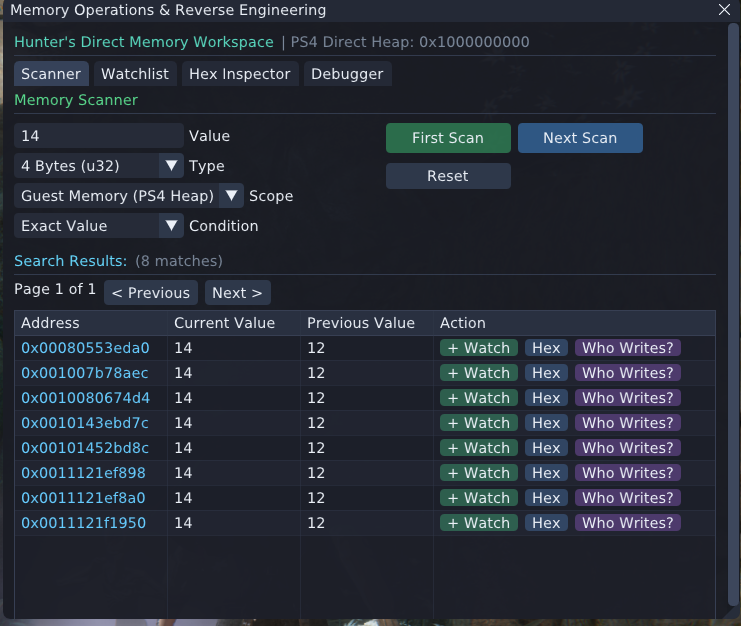
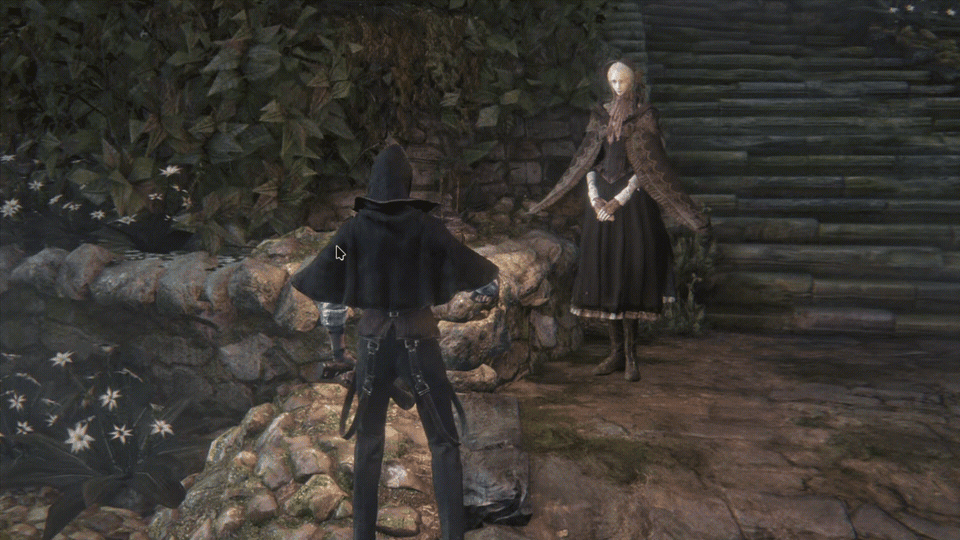

> [!IMPORTANT]
> **THIS PROJECT IS NOT RELATED TO SHADPS4.**
> All questions regarding the original porting project should be directed to the original creator's Discord server: **https://discord.gg/KYZRKk9CB**, NOT to the shadPS4 server.
>
> **Original Upstream Repository:** [https://github.com/deadinside28/bloodborne_pc](https://github.com/deadinside28/bloodborne_pc) (created by [deadinside28](https://github.com/deadinside28))

# bbport (Custom Fork) — Native Linux Port of Bloodborne

**English** · [Русский](README.ru.md)

> [!NOTE]
> **About this Fork:**
> This repository is a **simple personal fork** of the original [bbport](https://github.com/deadinside28/bloodborne_pc) by **deadinside28**. It introduces a collection of quality-of-life enhancements, refined user interfaces, expanded gamepad integration, and visual indicators tailored to personal taste, while preserving the high-performance native execution architecture of the upstream project.

---

## ✨ Fork Enhancements & Highlights

Here are some of the key additions and custom improvements featured in this fork:

### 1. In-Game Virtual Keyboard with Full Gamepad Navigation
Creating a character name no longer requires a physical keyboard! An on-screen virtual keyboard is integrated directly into the character creation screen with complete controller navigation, button glyphs, and responsive physical keyboard support.



- **Gamepad Controls:**
  - **D-Pad / Left Stick**: Move cursor across letters and buttons
  - **(A / ✕)**: Insert character
  - **(X / ▢)**: Backspace / Delete
  - **(Y / △)**: Space
  - **(LB / RB / L1 / R1)**: Toggle Caps Lock
  - **(Start)**: Confirm / OK
  - **(B / ◯)**: Cancel / Close
- **Keyboard Support**: Physical typing with Backspace, Space, Enter, and Esc.

---

### 2. AMD FSR 3.1 Frame Generation (FG)
Experience Bloodborne with dramatically elevated smoothness via integrated **FSR 3.1 Frame Generation**, switchable directly in real-time from the in-game overlay menu.



- Interpolates intermediate frames using native motion vectors, scene depth, and reactivity masks.
- Easily reach 60 to 120+ FPS on compatible hardware for fluid combat.

---

### 3. Redesigned In-Game Overlay Menu (Insert / L3+R3)
The in-game configuration overlay has been overhauled for better organization, clarity, and instant control over rendering technologies.



- **Multilingual UI**: Seamless switching between **English**, **Português (Brasil)**, and **Русский**.
- **Real-Time Upscaler Tweaks**: Instant toggles for FSR 4, FSR 4.1.1, FSR 3.1, and TAA.
- **Reactivity Masks & Motion Vectors**: Fine-tune reactivity scale, threshold, max values, and character motion vectors with live visual debug modes.
- **Live Output Resolution & Visual Effects**: Adjust display resolution, RCAS sharpness slider, subpixel jitter, Chromatic Aberration, and Depth of Field (DoF).

---

### 4. Background Shader Compilation HUD Indicator
No more wondering why a micro-stutter occurred! A sleek, non-intrusive status spinner and progress bar appear on the HUD whenever background asynchronous shaders are compiling.



- Real-time framerate, frametime, upscaler state, and compilation status: `59 \ 59 FPS 16.9 ms FSR 4 + FG | ◷ Shaders`.

---

### 5. Organized GTK4 Launcher & Native Gamepad Navigation
The launcher has been reorganized into clean, dedicated preference groups with full Brazilian Portuguese (`pt-BR`) localization and complete gamepad navigation.



- **Launcher Gamepad Navigation**: Navigate tabs, rows, toggles, sliders, and launch the game directly using your controller (Xbox, DualShock 4, DualSense, Switch Pro, Steam Deck).
- **Dynamic Hints Bar**: Displays connected controller model and available button shortcuts (`[LB/RB] Tabs`, `[D-Pad] Navigate`, `[A] Select`, `[B] Back`, `[Y] Focus Play`, `[Start] Launch`, `[RS] Scroll`).
- **Bloodborne Red Outline**: Prominent focus outline for couch gaming or handheld display modes.

---

### 6. In-Game Memory Scanner & Reverse Engineering Debugger Suite
Explore, reverse-engineer, and modify Bloodborne's runtime state live without external tools! Directly accessible from the in-game overlay menu (`Insert` / `L3+R3` → *Memory & Reverse Engineering*), this floating window provides a Cheat Engine-grade memory and debugging suite running natively on Linux.



- **Asynchronous Memory Scanner (`[Scanner]`)**:
  - Non-blocking multithreaded scanning across 10 data types (`u8` to `u64`, `Float`, `Double`).
  - Scans across `Executable & .data`, `Guest Memory (PS4 Direct Heap: 0x1000000000)`, or `Full Process`.
  - Filter by `Exact Value`, `Changed`, `Unchanged`, `Increased`, and `Decreased`.
  - Instant 1-click actions: Add to Watchlist (`[+ Watch]`), inspect in Hex view (`[Hex]`), or track what writes (`[Who Writes?]`).
- **Interactive Watchlist & Multi-Level Pointer Chains (`[Watchlist]`)**:
  - Support for multi-level pointer chains (`Base + Offsets`, e.g. `[[0x80553B130] + 0x08] + 0x94`) with real-time resolution, live preview, and crash-safe dereferencing.
  - Pin addresses with real-time value updates and live 60Hz background memory freezing.
  - Native **`.bbt` (Bloodborne Table)** table persistence: saves and restores structured JSON cheat tables directly in `user/cheats/` (`Save .bbt` / `Load .bbt`) with auto-persistence.
  - Interactive data type switching, click-to-copy address, and quick deletion.
- **Hex Inspector & Data Card (`[Hex Inspector]`)**:
  - 16-byte aligned live memory grid with ASCII view, navigation history (`<` / `>`), address offsets, and jump presets (`eboot Base`, `Heap`, `Params`).
  - Multi-type decoder card simultaneously interpreting bytes as `u8`, `u16`, `u32`, `i32`, `Float`, and `Double` with direct memory write capabilities.
- **Hardware Watchpoints & Real-Time Debugger (`[Debugger]`)**:
  - Memory write protection via `mprotect(PROT_READ)` with lock-free `SIGSEGV`/`SIGTRAP` ring buffers.
  - Interactive x86-64 disassembler powered by Zydis with jump/call highlighting and active RIP tracking.
  - Dynamic instruction NOP patching (`[NOP]`) with instant, non-destructive restoration (`[Restore]`).
  - Full 64-bit CPU register snapshot viewer (`RAX`–`R15`, `RIP`, `RFLAGS`) with 1-click clipboard export.

---

## 🏛️ What is bbport?



`bbport` is the counterpart of Wine + DXVK engineered specifically for a single game: **Bloodborne** for PlayStation 4 (CUSA03173, game version 1.09) on an x86-64 Linux PC. The game's original executable runs directly on the PC:

- **As in Wine**, the game's x86-64 code runs directly on the CPU, and a runtime written for this one game replaces the PS4 system libraries (`src/runtime_*.c`).
- **As in DXVK**, the game's graphics are translated to Vulkan by the port's own renderer and shader translator (`gpu/`), including temporal upscaling with AMD FSR 3.1, FSR 4, FSR 4.1.1, and NVIDIA DLSS.
- **Memory and GPU work** follow the PC model on every GPU by default (the new memory and translation model, since 0.6); the old memory model of 0.3 remains as a launcher option (*Memory model → Old*).

> **No game files or copyrighted assets are included.**
> You must supply your own decrypted dump of Bloodborne with update 1.09 (any retail edition: CUSA03173, CUSA00900, CUSA03023, etc., as they share the same executable).
> This project is not affiliated with Sony Interactive Entertainment, FromSoftware, or AMD.

**Status: experimental, playable.** The game boots, loads saves, and plays (the Hunter's Dream and several areas of Yharnam were played with it) with sound, gamepad, and saving.

---

## ⚡ Core Architecture & Highlights

- **Native execution.** The eboot is converted offline into a flat memory image; PS4 libc and libSceFios2 are linked into it as native code. No CPU emulation and no per-instruction translation: the game code runs at full speed.
- **Two memory models** (launcher → *Mode → Memory and translation model*; *Auto*, the default, is the new one on every GPU):
  - **The new memory and translation model — default on every GPU (0.6).** The game's memory lives in system RAM and the GPU reads it where it is, as a PC game's buffers; data it reads often is kept in VRAM and given back when unused (textures after 20 s, buffers after 60 s). The layer's memory module tracks CPU writes to mirrored blocks to keep those copies coherent; it does not copy the whole GPU-visible memory. The PS4 command processor's work is translated into Vulkan commands rather than emulated on the CPU: memory writes (`WRITE_DATA`, DMA) are done by the GPU in command-stream order, and fences are written by the GPU itself at the end of the pipeline. On every GPU the game's memory goes through the layer's memory module: bound in place, VRAM copies as separate buffers, no sparse binding; `BB_LAYER_MEMORY=0` gives AMD's sparse arena. A driver that fails startup checks falls back to VRAM copies automatically. Without the launcher: `BB_PC_MODEL=1/0` (unset: the new one, as *Auto*).
  - **The old memory model, as in 0.3** (*Old*). VRAM copies of the game's memory, writes tracked through page protection, with every fix made since 0.3.
  - Unused textures are freed in both modes, so VRAM no longer grows unboundedly with every area visited.
- **Unlocked frame rate.** Hooks in the game's code make the simulation use the real frame time (the community patches in `patches/Bloodborne.xml` remain for comparison, `BB_FRAME_HOOKS=0`); ~90 FPS at 4K with FSR 4 Balanced on an RX 7800 XT, ~150 FPS at 1440p with FSR 4 Quality. Also 30/60/90 FPS modes; **F3** toggles a 30 FPS limit on and off while playing (some cinematics, e.g. Laurence's, are safest at 30).
- **Any aspect ratio, live.** 4:3, 16:10, 16:9, 21:9 and 32:9 with the HUD at the screen's edges, through hooks (the game's code is not patched); cinematics are wide too.
- **Keyboard and mouse.** Mouse look turns the game's camera directly; a mouse pointer in the game's menus (F1 releases the mouse); a layout close to Dark Souls III (Space dodge, Left Shift run, Shift+Space jump); movement keys ramp up smoothly like a stick; button prompts show bound keys or connected gamepad buttons.
- **Online play and seamless co-op.** Two pools on shadPS4 0.20's network stack (`gpu/bbnet20`): **Seamless Hunt** (default; bells, summons, messages, bloodstains and seamless co-op, BBSC, up to five hunters; account from seamlesshunt.com) and **The Hunter's Dream** (sign-in with Discord; no BBSC).
- **Temporal upscaling built for this game.** Bloodborne has no velocity buffer, so bbport computes motion vectors itself: camera motion from depth and scene matrices, and object motion (characters, cloth, weapons) from vertex positions of the previous frame. The scene is jittered sub-pixel (Halton) and rendered at a reduced resolution; the upscaler reconstructs the output (720p for Steam Deck, 1080p, 1440p, 2160p) and UI draws natively at output resolution.
  - **FSR 3.1** (FireBurn/FSR-Vulkan).
  - **FSR 4 (INT8, model v07)** on GPUs exposing required Vulkan shader features.
  - **FSR 4.1.1**: AMD's 4.1.1 DLL is recorded once under vkd3d-proton and its passes are replayed natively on Vulkan; the output is **bit-exact** with the DLL. Two variants: INT8 on any GPU with required shader features, and FP8 matrices on RDNA4 (RX 9000; chosen automatically).
  - Rewritten final passes of FSR 4 and 4.1.1 on RDNA3 store through workgroup memory (3.5× and 2.3× faster, bit-exact); FSR 4 costs ~4 ms at 4K on an RX 7800 XT instead of ~6 ms.
- **Multi-threaded GPU command processing.** The PS4 command stream is decoded on one thread and draws are bound and recorded on another (two-stage pipeline), with a Vulkan recording thread and helper threads for memory copies.
- **Settings inside the game's own menu:** *System → Display / Effects* (after *Screen/Sound*), built and drawn by the game itself in the game's language.
- **Overlay menu** (`Insert` or `L3+R3`), styled like the game's dialogs, with gamepad, keyboard, and mouse support.
- **GTK4 launcher** and **AppImage** for Linux desktop and Steam Deck.

---

## 📊 How it Differs from shadPS4

| Feature | shadPS4 | bbport |
| :--- | :--- | :--- |
| **Scope** | General PS4 emulator for many games | Single game: Bloodborne v1.09 |
| **Loading** | ELF loader & kernel emulation at run time | Offline conversion (`scripts/`) into an image with PS4 libc/Fios2 linked in; C loader maps it and jumps directly into the game |
| **Memory** | VRAM copies of PS4 memory synchronized via page-protection write tracking | Default: new memory and translation model (game memory in system RAM, used in place by GPU, frequently read data in VRAM, freed when unused). 0.3 model available as option |
| **Command Processor** | Emulated: memory writes, DMA, and fences handled by CPU while decoding | Translated into Vulkan commands executed by GPU in stream order; fences written by GPU after work completes |
| **System Libraries** | Broad HLE of the PS4 OS | Lightweight runtime (`src/runtime_*.c`) implementing what Bloodborne calls: memory, threads, sync, files, audio (ATRAC9), pad, saves, AppContent |
| **GPU Pipeline** | General shadPS4 video core and shader recompiler | Dedicated command processor, renderer, caches, and shader translator: two-stage draw pipeline, render-state and texture-set memoization, render-scale proxies, motion vectors, FSR 3.1/4/4.1.1, DLSS, frame capture, and GPU profiler |
| **GPU Threading** | Single thread processes the entire command stream | Decode and draw recording run on separate threads; work scales across hardware threads |
| **Upscaling** | Basic or none | Temporal upscaling (FSR 3.1, FSR 4, FSR 4.1.1, DLSS, TAA) with game's own motion vectors and jitter |
| **Game Patches** | Applied by emulator at launch | Community patches compiled at start (`scripts/patches.py`); render resolution, effects, and FPS managed via launcher/hooks |

---

## ⚙️ Requirements

- **Linux x86-64, Vulkan 1.3 GPU.** Tested: AMD RX 7800 XT with Mesa 26 (RADV); NVIDIA and Intel supported. FSR 4 / 4.1.1 require shader Float16, Int8/Int16, integer dot products, linear compute derivatives and extended storage image formats; FSR 4.1.1 additionally requires `VK_VALVE_shader_mixed_float_dot_product`. Unsupported choices fall back to FSR 3.1 or TAA.
- **Decrypted Game Dump:** The `CUSA03173` folder (`eboot.bin`, `sce_module`, ...) updated to version **1.09**. A dumped update is a separate folder: copy it over the base game, replacing files. (The base game alone 1.00 crashes at start; the launcher and `run.sh` verify the executable). Other retail releases (`CUSA00900`, `CUSA03023`, ...) run the same 1.09 executable.
- **Build Tools:** GCC, CMake, Ninja, Python 3, glslang, SDL3, Vulkan headers, and libraries in `shell.nix`. With Nix everything is provided automatically.

---

## 📦 Installing Prerequisites & Dependencies

### Arch Linux / Manjaro / EndeavourOS
```bash
sudo pacman -S --needed base-devel git cmake ninja pkgconf python \
    vulkan-headers vulkan-icd-loader sdl3 glslang boost fmt xxhash \
    zydis xbyak ffmpeg protobuf openssl zlib miniupnpc nlohmann-json \
    libadwaita python-gobject
```

### Ubuntu (24.04 LTS+) / Debian (Trixie/Sid) / Linux Mint
```bash
sudo apt update && sudo apt install -y build-essential git cmake ninja-build pkg-config \
    python3 python3-pip libvulkan-dev libsdl3-dev glslang-tools libboost-all-dev \
    libfmt-dev libxxhash-dev libavcodec-dev libavutil-dev libswresample-dev \
    libprotobuf-dev protobuf-compiler libssl-dev zlib1g-dev libminiupnpc-dev \
    nlohmann-json3-dev python3-gi python3-gi-cairo gir1.2-adw-1 gir1.2-gtk-4.0
```
> [!NOTE]
> If `libsdl3-dev` is not available in your distribution's default repositories, compile SDL3 from source or install via official SDL releases.

### Fedora (40+) / Nobara / Bazzite
```bash
sudo dnf install -y gcc-c++ git cmake ninja-build pkgconf-pkg-config python3 \
    vulkan-headers vulkan-loader-devel SDL3-devel glslang boost-devel fmt-devel \
    xxhash-devel ffmpeg-free-devel protobuf-devel openssl-devel zlib-devel \
    miniupnpc-devel json-devel libadwaita-devel python3-gobject
```

### NixOS / Steam Deck (using Nix)
No manual dependency installation is needed! The project includes a fully defined [`shell.nix`](shell.nix). Simply enter the environment:
```bash
nix-shell --run "bash build.sh"
```

---

## 🚀 Building & Compiling

### 1. Clone this Repository (with submodules)
```bash
git clone --recursive https://github.com/SrShadowy/bloodborne_pc.git bbport
cd bbport
```
> [!TIP]
> If you already cloned without `--recursive`, initialize submodules with:
> ```bash
> git submodule update --init --recursive
> ```

### 2. Compile the Binaries
```bash
bash build.sh
```
This builds:
* `out/gpu/libbbgpu.so`: Vulkan translation renderer, shader recompiler, FSR pipeline, and in-game overlay.
* `out/gpu/libbbnet20.so`: The online module (shadPS4 v0.20 network stack, BBSC seamless co-op, and The Hunter's Dream backend).
* `out/libatrac9.a`: High-performance native ATRAC9 audio decoder.
* `out/bb-probe`: Native x86-64 Linux loader and PS4 HLE runtime.
* `out/bb-gpu-capabilities`: GPU capability probe for automatic resolution, display, and controller detection.

### 3. Advanced Compilation Options
| Environment Variable | Description | Example |
| :--- | :--- | :--- |
| `BB_MARCH=native` | Compiles with host CPU optimizations (AVX2, FMA, BMI2) for maximum framerate | `BB_MARCH=native bash build.sh` |
| `BB_LTO=OFF` | Disables Link-Time Optimization for faster build times | `BB_LTO=OFF bash build.sh` |
| `BB_PGO=generate` / `use` | Profile-Guided Optimization | `BB_PGO=use bash build.sh` |
| `DLSS_SDK_ROOT=<path>` | Enables NVIDIA DLSS bridge using the NVIDIA DLSS SDK | `DLSS_SDK_ROOT=~/DLSS bash build.sh` |
| `--test` | Builds and runs the automated test suite | `bash build.sh --test` |

---

## 🎮 Launching the Game

### Method A: GTK4 Launcher (Recommended)
```bash
bash launcher/bb-launcher.sh
```
*(Optionally run `launcher/install-desktop.sh` to add Bloodborne to your desktop app launcher).*

### Method B: Direct Terminal Launch
```bash
BB_GAME_DIR="/path/to/CUSA03173" bash run.sh
```

---

## 🎮 Controls & Shortcuts

| Context | Input | Action |
| :--- | :--- | :--- |
| **In-Game Overlay** | `Insert` or `L3 + R3` | Open / Close the in-game settings overlay |
| **Memory Tools Suite**| Overlay (`Insert`) → *Memory Tools* | Open floating memory scanner, watchlist, hex editor & debugger |
| **Character Name** | In-game dialog | Interactive virtual keyboard (controller & physical keyboard) |
| **30 FPS Toggle** | `F3` | Toggle 30 FPS frame rate limit (useful for Laurence's cinematic) |
| **Mouse Release** | `F1` | Release mouse cursor from game window |
| **Launcher Navigation** | `D-Pad` / `Left Stick` | Move focus between launcher settings and categories |
| **Launcher Values** | `D-Pad Left/Right` | Adjust sliders, cycle combo options, and toggle switches |
| **Launcher Pages** | `LB` / `RB` (L1 / R1) | Switch launcher tabs |
| **Launcher Quick Play**| `Start` or `Y` | Immediate game launch / focus main action button |
| **Touchpad Gestures** | Left Touchpad / `Tab` | Open gestures menu (or retail Debug Menu if patch enabled) |
| **Touchpad Items** | Right Touchpad / `Backspace` | Open personal items menu |
| **Free Camera** | Hold `✕` + press `L3` | Cycle camera modes (requires free camera patch; keyboard: hold `F` + press Left `Ctrl`) |
| **FromSoftware Debug Menu** | Left Touchpad / `Tab` | Requires patch enabled + font files (`DbgFont14h.ccm`/`.tpf`) from [Nexus #253](https://www.nexusmods.com/bloodborne/mods/253) in `dvdroot_ps4/font/` |

---

## 🔧 Configuration, Upscalers & Features

### Resolution and Preset Changes
For outputs other than 1080p (720p on Steam Deck, 1440p, 4K), the whole game renders at the preset resolution set by a patch at start (fastest path). Changing output or preset in the in-game menu requires *Apply and restart the game*.
The *Live resolution changes* setting (`bbport.ini` `live_resolution=0|1|auto`, off by default) keeps the game at 1080p internally and scales render targets at runtime so 720p/1080p/1440p/4K and presets switch without a restart (`auto` turns it on for discrete GPUs with 8+ GB that are not pre-Turing NVIDIA).

### TAA
A separate native-resolution temporal AA mode in the launcher and overlay, switchable live without an FSR model. The RCAS sharpness slider (0–2) works with TAA as well.

### Mods & Patches
The launcher accepts loose-file mod folders (with `dvdroot_ps4/` or game folders like `chr/` directly). Sibling `CUSA03173-mods/` overlay also works.
Community patches are located in `patches/Bloodborne.xml` and can be toggled in the launcher. DLC add-on dumps go into `user/addcont/<title id>/<entitlement label>/` (e.g. `user/addcont/CUSA03173/SPEXPANSIONDLC03` for The Old Hunters).

### GPU Choice
*Mode → GPU* in the launcher selects the graphics card on multi-GPU setups (*Auto* prefers discrete GPU; stored by name; `BB_GPU_ID=N` from the shell wins).

### FSR 4.1.1 from Your Own DLL
In the launcher: *Upscaler → FSR 4.1.1 from your own AMD DLL → Choose DLL…*, then pick `amd_fidelityfx_upscaler_dx12.dll` version 4.1.x (from OptiScaler or a game with FSR 4.1). The DLL is recorded at 20 sizes under Proton and translated to SPIR-V for native Vulkan replay (bit-exact). Command-line alternative: `python3 launcher/bbport_launcher.py --build-fsr411 <DLL>`.

### NVIDIA DLSS (GeForce RTX)
Check out [github.com/NVIDIA/DLSS](https://github.com/NVIDIA/DLSS) and build with `DLSS_SDK_ROOT=/path/to/DLSS bash build.sh`. This builds `out/libbbport_dlss.so` (`gpu/dlss_bridge`) and copies `libnvidia-ngx-dlss.so.<version>` next to `out/bb-probe`. In the launcher or overlay menu, select *DLSS* (Native AA is DLAA).

### FP8 on RDNA4
When vkd3d-proton offers FP8 cooperative matrices (RDNA4), both INT8 (`fsr4_411/`) and FP8 (`fsr4_411/fp8/`) passes are recorded, and the game automatically picks FP8 on GPUs with `VK_EXT_shader_float8`. `BB_FSR411_VARIANT=int8` forces INT8.

### AppImage & Steam (Steam Deck)
Build standalone AppImage: `bash build.sh && bash packaging/appimage.sh` → `dist/Bloodborne-bbport-x86_64.AppImage`.
*Add a Non-Steam Game* in Steam. Where Steam runs without FUSE (NixOS FHS sandbox), set launch options to:
```
TMPDIR=$HOME/.cache APPIMAGE_EXTRACT_AND_RUN=1 NO_CLEANUP=1 %command%
```
Add ` --play` after `%command%` to skip the launcher directly into the game.

### NVIDIA in the AppImage
Startup discovers the host's installed 64-bit NVIDIA Vulkan ICD and exposes vendor libraries alongside bundled AMD/Intel drivers. If libraries are hidden (e.g. NixOS), set `BB_NVIDIA_LIB_DIR=/path/to/libraries`. Diagnose with:
```bash
./Bloodborne-bbport-x86_64.AppImage --vulkan-info 2>&1 | tee bbport-vulkan.log
```

### Useful Environment Variables
| Variable | Description |
| :--- | :--- |
| `BB_FRAME_STATS=1` | Frame statistics (frametimes, VRAM, GTT, RSS, image allocations) |
| `BB_PC_MODEL=1/0` | `1` = New memory and translation model (default), `0` = Old 0.3 memory model |
| `BB_ANISO=N` | Anisotropic filtering of scene textures (default: 16; 0 = game default) |
| `BB_GC_IDLE_SECONDS=N` | How long unused textures remain in VRAM before freeing (default: 20) |
| `BB_VRAM_IDLE_SECONDS=N` | How long unused buffers remain in VRAM before freeing (default: 60) |
| `BB_BREADCRUMBS=0` | Disable GPU breadcrumbs (breadcrumbs identify hung draws/dispatches) |
| `BB_GPU_PROFILE=1` | GPU execution time breakdown per pass |
| `BB_FSR4_PROFILE=1` | GPU time per FSR 4 pass |
| `BB_UPSCALER=...` | Set upscaler: `taa`, `fsr3`, `fsr4`, `fsr411`, `dlss`, `off` |
| `BB_FRAMES_AHEAD=N` | Maximum frames GPU command thread can run ahead of GPU (default: 1; 0 = unbounded) |
| `BB_PRESENT_THREAD=0` | Present on vblank thread instead of presentation thread |
| `BB_LIVE_RES=1` | Enable live resolution scaling |
| `BB_PAD_RECORD=file` / `BB_PAD_REPLAY=file` | Record input route with F9 and replay in scripted tests |
| `BB_READBACKS=0/1/2` | CPU reads of GPU-written memory (1 = default, 2 = precise, 0 = off) |
| `BB_RENDER_RESOURCE_CACHE_MB=160` | Render resource cache size (default: 512 MiB) |

### Online Play
The online module `out/gpu/libbbnet20.so` (`gpu/bbnet20`: shadPS4 v0.20 network stack, BBSC, and The Hunter's Dream backend) enables multiplayer when configured in the launcher (`BB_ONLINE=1`):
- **Seamless Hunt** (default): Uses shadNet (`play.seamlesshunt.com:31313`, WebAPI `:31315`) with BBSC game server. Enables bells, summons, messages, bloodstains, and **seamless co-op (BBSC)** where sessions survive deaths, lamps, area transitions, and bosses with up to 5 players. Account registered at https://seamlesshunt.com.
- **The Hunter's Dream** (thehuntersdream.com): Sign in with Discord from the launcher (code confirmed in browser).
- The legacy module `libbbnet.so` remains available as fallback via `BB_NET_GEN=19`. Offline play never loads the network module.

---

## 📁 Repository Layout

| Path | Purpose |
| :--- | :--- |
| `src/` | Native loader (`probe.c`) and high-level emulation (HLE) runtime (`runtime_*.c`) |
| `gpu/` | Vulkan translation renderer (command processor, shader translator, FSR 4.1.1 replayer, Frame Generation, overlay, and online module `gpu/bbnet20`) |
| `launcher/` | Modern GTK4 / Libadwaita launcher with full controller navigation, i18n, and settings persistence |
| `prints/` | Screenshots showcasing custom fork enhancements, UI redesigns, and controls |
| `scripts/` | Image linker, eboot unpacker, libc/fios2 linkers, XML patch compiler, and online helpers |
| `patches/` | Community performance and graphics patches (`Bloodborne.xml`) |
| `tools/` | Developer utilities: `fsr4cap`, automated benchmarks, asset downloaders, and test scripts |
| `tests/` | Comprehensive test suite (115+ automated unit tests for runtime, patches, and gamepad navigation) |
| `docs/` | Technical design documentation, measurements, and architectural roadmap |

---

## 🗺️ Roadmap & Upstream Plans
- Remove old memory model once new model is verified across NVIDIA and Intel hardware.
- Textures as objects created at load time (less guessing by address, uploads outside frame).
- Shaders translated ahead of time at install rather than during play.
- Increased CPU parallelism in GPU command processing (split draw-recording stage further).
- Async compute for upscaler passes.
- XeSS super resolution and XeFG frame generation through Wine Vulkan memory bridge.
- Official FSR 3.1 Frame Generation refinement.

---

## 🏆 Credits, Attribution & Licenses


`bbport` is distributed under the **GNU General Public License v2.0 or later** ([LICENSE](LICENSE)). Third-party components, libraries, and patches retain their respective original licenses.

### Upstream Project & Port Architecture
- **Original Project Creator:** [deadinside28](https://github.com/deadinside28) ([deadinside28/bloodborne_pc](https://github.com/deadinside28/bloodborne_pc)) — Architect of bbport: native x86-64 execution, Wine-style PS4 HLE runtime (`src/runtime_*.c`), memory arena model, offline eboot/ELF conversion, parallel GPU decoding/recording pipeline, and custom motion vector generation.
- **Official Creator Discord:** [https://discord.gg/KYZRKk9CB](https://discord.gg/KYZRKk9CB) — Primary community server for upstream development and bug reports.

### Emulation & Graphics Translation
- **[shadPS4](https://github.com/shadps4-emu/shadPS4)** (GPL-2.0+): The core video renderer and shader recompiler that form the foundation of bbport's graphics translation engine.
- **[sirit](https://github.com/shadps4-emu/sirit)** (shadPS4 project): Lightweight SPIR-V runtime assembly generation library.
- **[shadNet / shadp2p](https://srv.shadps4.net)**: Online networking client and server infrastructure.
- **[shadPS4 v0.20](https://github.com/shadps4-emu/shadPS4/tree/v.0.20.0)**: Network, NP, and web API implementation for `libbbnet20.so`.
- **[BBSC](https://github.com/CLSAMG22/BBSC)** (GPL-2.0+): Seamless co-op system integrated into the online module.
- **[droogie/bbhost](https://github.com/droogie/bbhost)** (GPL-3.0+): The Hunter's Dream backend for `libbbnet20.so`.
- **Khronos Group & Vulkan**: The Vulkan 1.3 low-level graphics API, validation layers, and SPIR-V tooling.
- **Wine & DXVK Projects**: The foundational concept and architectural inspiration for native Linux single-game translation runtimes.

### Upscaling, Reconstruction & Frame Generation
- **[AMD FidelityFX SDK](https://github.com/GPUOpen-LibrariesAndSDKs/FidelityFX-SDK)** (MIT): FidelityFX Super Resolution (FSR 3.1) algorithms, Robust Contrast Adaptive Sharpening (RCAS), subpixel jittering, and Frame Generation interpolation pipeline.
- **[FSR-Vulkan](https://github.com/FireBurn/FSR-Vulkan)** by FireBurn (MIT): Native Vulkan implementations of AMD FSR 3.1 and the FSR 4 v07 provider.
- **FSR 4.1.1 Replay Pipeline**:
  - **[dxil-spirv](https://github.com/HansKristian-Work/dxil-spirv)** by Hans-Kristian Arntzen (MIT): Translates DirectX 12 DXIL passes into native Vulkan SPIR-V compute shaders for bit-exact execution in `fsr4cap`.
  - Research and model workflows inspired by the **OptiScaler** and **Goverlay** open-source communities.
- **[NVIDIA DLSS SDK](https://github.com/NVIDIA/DLSS)**: Deep Learning Super Sampling technology and NGX Linux runtime library.
- **[Supermedo's Windows Port](https://github.com/Supermedo/bloodborne_pc)** & **[IFreemz](https://github.com/IFreemz/shadPS4-Bloodborne-DLSS-FSR)**: The original DLSS bridge concept, loader integration, and motion vector hooks.

### Input, Gamepad & Virtual Keyboard
- **[SDL3 (Simple DirectMedia Layer 3)](https://www.libsdl.org/)** (zlib): Low-latency controller input, unified gamepad mappings (Xbox 360 / One / Series, PlayStation DualShock 4 / DualSense, Nintendo Switch Pro, Steam Deck), hotplugging detection, and analog stick polling across both the game runtime and the GTK4 launcher.
- **Custom In-Game Virtual Keyboard**: Built specifically for the character creation contract screen with full controller navigation, button glyphs, and physical keyboard support.
- **GTK4 Gamepad Navigator**: Custom SDL3-powered navigation engine for the GTK4 / Libadwaita launcher, supporting D-Pad navigation, smooth analog scrolling, popover choice dropdowns, and modal dialogs.

### Audio, Typography & User Interface
- **[LibAtrac9](https://github.com/Thealexbarney/LibAtrac9)** by Thealexbarney (MIT): High-performance native ATRAC9 audio decoding for PlayStation 4 audio streams, sound effects, and orchestral music.
- **[Dear ImGui](https://github.com/ocornut/imgui)** by Omar Cornut (MIT): Lightweight in-game configuration overlay and real-time performance metrics HUD.
- **[GNOME / Libadwaita & GTK4](https://gitlab.gnome.org/GNOME/libadwaita)** (LGPL-2.1+): Modern, accessible desktop launcher interface with custom CSS theming, organized preference groups, and i18n support.
- **[DejaVu Fonts](https://dejavu-fonts.github.io/)**: Clear, high-legibility Unicode fonts used in the game overlay and debugging menus.

### Reverse Engineering & Memory Tools
- **[Zydis](https://github.com/zyantific/zydis)** (MIT): Fast and lightweight x86-64 disassembler library powering the in-game live instruction view and real-time disassembler.
- **Custom Asynchronous Memory Engine**: Non-blocking multithreaded memory scanner, lock-free signal-based page watchpoints (`mprotect` + `SIGSEGV`/`SIGTRAP` ring buffer), interactive live watchlist, and hex data inspector engineered directly into the Vulkan overlay.

### Game Patches, Modding & Community Research
- **Lance McDonald**: Pioneer of the Bloodborne 60 FPS patch, physics delta time decoupling research, frame pacing analysis, GoldHEN free camera patch, and game internals exploration.
- **Kyo**: Motion vector extraction hooks, simulation delta scaling, and graphics patches.
- **auser1337, illusion, emoose, and the Bloodborne modding community**: Resolution patches, game effects toggles (DoF, Chromatic Aberration), XML patch compilation, and modding tools (`patches/Bloodborne.xml`).
- **FromSoftware & Sony Interactive Entertainment**: The original creators and publishers of Bloodborne (CUSA03173 / CUSA00900 / CUSA03023).

### Packaging, Monitoring & System Tools
- **[MangoHud](https://github.com/flightlessmango/MangoHud)**: Performance monitoring, FPS, and frametime tracking overlay.
- **Nix / NixOS & AppImageKit**: Reproducible development environment (`shell.nix`) and standalone portable package creation for Linux desktops and the Steam Deck.