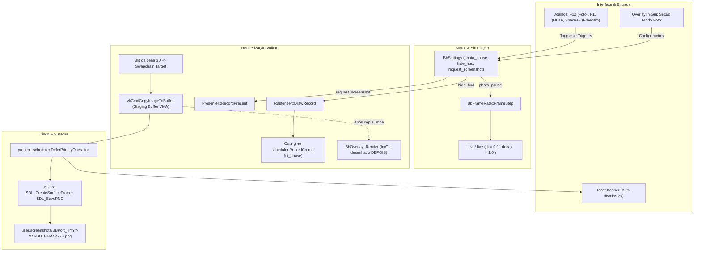

# Modo Foto (Photo Mode) no BBPort: Arquitetura e Planejamento Técnico

Este documento detalha a concepção, o planejamento técnico e a implementação do **Modo Foto (Photo Mode)** nativo no BBPort. O recurso permite pausar a simulação do mundo e a IA dos inimigos sem travar a renderização gráfica, ocultar cirurgicamente o HUD/Scaleform do jogo, capturar fotografias em alta resolução totalmente livres de sobreposições de menu e ajustar parâmetros de câmera e pós-processamento em tempo real.

---

## 1. Visão Geral e Requisitos

O objetivo do Modo Foto é oferecer uma ferramenta completa de fotografia in-game diretamente integrada ao menu overlay ImGui (`Insert` / `L3+R3`) e acessível por atalhos de teclado e controle.

### Requisitos Principais:
1. **Congelamento da Simulação / IA (World Freeze)**:
   - Paralisar chefes, inimigos, animações de personagens, física de tecidos (*cloth*), projéteis e partículas.
   - Manter o laço de renderização Vulkan ativo em alta performance (60/120+ FPS) e a câmera totalmente navegável.
2. **Ocultação Limpa do HUD (HUD Suppression)**:
   - Esconder barras de vida, estâmina, retículo de mira, caixas de diálogo, legendas e prompts de botões.
   - Manter o cenário 3D e os efeitos de pós-processamento (Bloom, névoa, iluminação) intactos.
   - Manter o menu ImGui do port visível por cima para que o usuário possa fazer os ajustes necessários.
3. **Mecanismo de Captura de Screenshot Imaculada (Pristine Capture)**:
   - Capturar o framebuffer na resolução final do monitor/swapchain em formato sem perdas (PNG).
   - Garantir 0% de vazamento de menus ImGui, contador de FPS ou notificações *toast* na imagem salva.
   - Salvar com nomenclatura baseada em data e hora em `user/screenshots/`.
4. **Controles de Câmera, Estilização e Feedback Visual**:
   - Ajustes em tempo real de FOV, Distância da Câmera, Altura da Câmera e Pós-Processamento (Bloom, Saturação Noir, Vinheta, SSAO, Névoa).
   - Atalhos globais utilizáveis a qualquer momento durante o gameplay (mesmo com menu fechado).
   - Notificações *toast* não invasivas na tela com auto-dismiss após 3 segundos.

---

## 2. Diagrama de Arquitetura



---

## 3. Engenharia de Congelamento da Simulação (Delta-Time Freeze)

### Arquivo: `gpu/shim/bbport_frame_rate.cpp`

No Bloodborne, toda a lógica de avanço temporal do jogo (física Havok, lógica de IA de inimigos, animações de chefes, scripts de combate e partículas) deriva do delta-time calculado no laço principal de pacing (`0x2018d20` / `0x2034770`).

O BBPort substitui as constantes estáticas de 30 FPS do jogo original por um bloco redirecionado em memória do hospedeiro (`struct Live* live`), cujos valores são recalculados a cada quadro pela função `FrameStep(u64 pacer)`:

```cpp
void PS4_SYSV_ABI FrameStep(u64 pacer) {
    if (BbSettings::Get().photo_pause.load(std::memory_order_relaxed)) {
        live->dt = 0.0f;
        for (float& d : live->decay95) d = 1.0f;
        live->approach30 = 0.0f;
        live->approach10 = 0.0f;
        live->step_down = 0.0f;
        live->step_up = 0.0f;
        live->decay08 = 1.0f;
        live->cloth = 1.0f;
        return;
    }
    // Cálculo normal da taxa de quadros...
}
```

### Por que esta abordagem é superior:
1. **Zero Deadlocks**: O thread do jogo não entra em *sleep* ou laço de espera bloqueante. Ele continua executando sua rotina regular, enviando pacotes para o command processor da GPU.
2. **Câmera e Renderizador Vivos**: O pipeline gráfico Vulkan e a thread de apresentação continuam rodando na taxa máxima do monitor (60, 120 ou 144+ FPS).
3. **Câmera Livre Operante**: Os parâmetros da matriz de projeção da câmera e o mod de Câmera Livre de Lance McDonald continuam lendo inputs do jogador e atualizando os ângulos de visão sem congelar a posição de observação.

---

## 4. Ocultação do HUD e Integridade do BufferCache

### Arquivo: `gpu/render/rasterizer.cpp`

O temporal upscaler do BBPort divide o quadro em fases bem definidas:
1. **Fase da Cena 3D**: Renderização de geometria, iluminação G-buffer, sombras e pós-processamento YEBIS.
2. **Upscaling Pass**: Execução do FSR 3 / FSR 4 / TAA para escalar a cena para a resolução de saída.
3. **Fase de Interface (`ui_phase`)**: O Scaleform desenha os elementos 2D (barras de vida, retículo, menus do jogo, legendas) sobre a imagem em resolução nativa do display.
4. **Passagem de Apresentação (`DisplayPass`)**: Transferência da imagem pronta para o swapchain.

### Lição Técnica Aprendida (`boost::container::bad_alloc`):
Inicialmente, tentou-se interromper os draws de interface com um `return;` prematuro no início de `Rasterizer::DrawRecord`:
```cpp
// ❌ ABORDAGEM PROBLEMÁTICA (Causava crash após alguns quadros):
PrepareRenderState(pipeline);
NoteUpscalerDraw(pipeline);
if (BbSettings::Get().hide_hud.load() && upscaler->InUiPhase()) {
    return; // Vaza pacotes alocados em buffer_cache.NewPacket()!
}
```

**Diagnóstico da Falha**: No início de cada draw, `buffer_cache.NewPacket()` reserva recursos em vetores estáticos internos da biblioteca Boost. Como o `return;` antecipado impedia a chamada de `ResetBindings(false)` e `scheduler.KickRecording()`, centenas de pacotes ficavam órfãos por segundo na memória do driver. Em poucos instantes, a capacidade máxima era atingida, lançando a exceção `boost::container::bad_alloc`.

### Solução Definitiva:
Em vez de abortar o método `DrawRecord`, todo o ciclo de vida dos buffers, binds e kick recording é mantido rigorosamente intacto. Apenas o comando real de envio à GPU é suprimido dentro de `scheduler.RecordCrumb`:

```cpp
//  ABORDAGEM ROBUSTA (Sem vazamento de memória):
const bool hide_ui_draw = BbSettings::Get().hide_hud.load(std::memory_order_relaxed) &&
                          upscaler->Enabled() && upscaler->InUiPhase() &&
                          !(regs.color_buffers[0] && FrameCapture::IsDisplayBuffer(regs.color_buffers[0].Address()));

scheduler.RecordCrumb(crumb, [=](vk::CommandBuffer cmdbuf) {
    if (hide_ui_draw) {
        return; // A GPU simplesmente não recebe comandos de desenho para o HUD
    }
    cmdbuf.bindPipeline(vk::PipelineBindPoint::eGraphics, handle);
    if (is_indexed) {
        cmdbuf.drawIndexed(num_indices, num_instances, 0, s32(first_vertex), first_instance);
    } else {
        cmdbuf.draw(num_indices, num_instances, first_vertex, first_instance);
    }
});

// ResetBindings(false) e KickRecording() continuam executando normalmente!
BB_SECTION(Kick);
ResetBindings(false);
scheduler.KickRecording();
```

---

## 5. Mecanismo de Captura de Screenshot (Vulkan & SDL3)

### Arquivo: `gpu/render/presenter.cpp`

Para assegurar que a fotografia seja 100% limpa, a captura não pode ser realizada da janela do sistema operacional (onde o ImGui já está misturado aos pixels).

O BBPort captura o `target` do swapchain exatamente **após** o blit da cena 3D dimensionada e **antes** de `BbOverlay::Render`:

```text
[Frame da Cena 3D] ──> blitImage() ──> [Swapchain Target] ──┬──> [LEITURA LIMPA PARA SCREENSHOT]
                                                            │
                                                            └──> BbOverlay::Render() ──> [Tela do Jogador]
```

### Passo a Passo no Vulkan:
1. **Transição de Layout**:
   O `target` é transicionado de `eTransferDstOptimal` para `eTransferSrcOptimal`.
2. **Alocação de Buffer Staging**:
   Um `VkBuffer` mapeado na CPU é criado via VMA com os sinalizadores `VMA_ALLOCATION_CREATE_MAPPED_BIT | VMA_ALLOCATION_CREATE_HOST_ACCESS_RANDOM_BIT`.
3. **Cópia GPU -> Buffer**:
   `cmdbuf.copyImageToBuffer(...)` transfere a imagem com aspect ratio e resolução exatas do swapchain para o buffer do host.
4. **Restauração de Layout**:
   O `target` é transicionado para `eColorAttachmentOptimal` (caso o overlay ImGui esteja ativo) ou `ePresentSrcKHR`.
5. **Gravação Assíncrona e Notificação**:
   Através de `present_scheduler.DeferPriorityOperation`, uma tarefa assíncrona na CPU executa após a conclusão dos comandos na GPU:
   - Invalida a faixa de memória com `vmaInvalidateAllocation`.
   - Constrói a superfície de imagem usando `SDL_CreateSurfaceFrom` com detecção de formato (`SDL_PIXELFORMAT_BGRA32` ou `SDL_PIXELFORMAT_RGBA32`).
   - Salva em disco via `SDL_SavePNG` no diretório `user/screenshots/BBPort_YYYY-MM-DD_HH-MM-SS.png`.
   - Dispara a notificação toast na tela com `BbOverlay::SetBanner(toast, 3.0f)`.
   - Destrói a alocação VMA.

---

## 6. Interface do Usuário, Atalhos e Toast Notifications

### Arquivos: `gpu/shim/bbport_overlay.cpp`, `bbport_overlay_sections.cpp` e `bbport_settings.h`

A nova seção **Modo Foto (Photo Mode)** foi posicionada no topo do menu de configurações do jogo.

### Controles Disponíveis no Menu ImGui:
- **Pausar Jogo (Congelar IA / Mundo)**: Checkbox atômico que alterna o congelamento de delta-time.
- **Ocultar HUD do Jogo (F11)**: Checkbox atômico que ativa a supressão de draws na fase de UI.
- **Tirar Foto (F12)**: Botão de ação que dispara a captura assíncrona de screenshot.
- **Abrir Pasta de Fotos**: Botão que dispara o comando do sistema (`xdg-open`) para abrir a pasta `user/screenshots/` no explorador de arquivos do sistema operacional (ex: Dolphin, Nautilus).
- **Restaurar Padrões de Câmera e Efeitos**: Reseta FOV, distância, altura e saturação para `1.0f`.

### Controles de Imagem e Fotografia Integrados:
- **FOV (Campo de Visão)**: De 0.80x a 1.40x.
- **Distância e Altura da Câmera**: Ajustam a distância do alvo e elevação do personagem.
- **Câmera Livre (Free Camera)**: `Space + Z` (teclado) ou `Cross + L3` (gamepad).
- **Saturação de Cores**: Permite tons vibrantes ou valor `0.0f` para fotografia estilo *Noir* / Preto e Branco.
- **Bloom, Vinheta, Névoa e SSAO**: Permite calibrar a atmosfera da captura.

### Atalhos Globais:
Os atalhos abaixo operam a qualquer momento durante o jogo, mesmo com o menu ImGui fechado:
| Atalho | Ação |
| :--- | :--- |
| **F12** ou **PrintScreen** | Captura e salva screenshot em PNG com notificação na tela |
| **F11** | Alterna visibilidade do HUD do jogo (On / Off) |
| **Insert** ou **L3 + R3** | Abre / Fecha o menu ImGui |
| **Space + Z** ou **Cross + L3** | Ativa / Desativa a Câmera Livre (Lance McDonald Freecam) |

### Notificação Toast Temporizada:
A função `BbOverlay::SetBanner(const char* text, float duration_seconds)` foi atualizada para gerenciar uma data de expiração (`banner_expire`). Sempre que uma foto é tirada ou o HUD é alternado, um banner sutil surge no terço inferior da tela confirmando a operação e desaparece automaticamente após 3 segundos.

---

## 7. Como Compilar

Para compilar as alterações com o ambiente completo de desenvolvimento do BBPort via Docker:

```bash
docker run --rm -u "$(id -u):$(id -g)" -v "$PWD":/bbport -w /bbport bbport-builder:ubuntu22 bash -c "ninja -C out/gpu bbgpu"
```

Para gerar o pacote de distribuição completo standalone:
```bash
./package.py --docker
```
